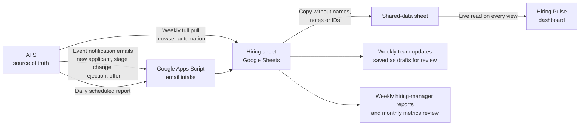

# Hiring Pulse

**A weekly decision dashboard for recruiting teams that tells everyone involved in hiring what to do next, not just what already happened.**

> The ATS shows how we've been hiring. The Pulse shows what to do next.

**[Try the interactive demo](https://brikonigin.github.io/ai-hiring-toolkit/hiring-pulse/demo/)** (runs on invented data, no setup needed). Source: [`demo/index.html`](demo/index.html).

Hiring Pulse was built while I ran recruiting at a startup. It sits on top of the company's applicant tracking system (ATS), turns its data into a small set of weekly actions, and puts those actions in front of hiring managers, leadership and the recruiter in plain language. All company names, people, roles, data and identifiers have been removed from this version; every example below uses invented data.

---

## The problem

Most hiring delays aren't caused by a lack of candidates. They're caused by small, invisible waits: an interviewer who hasn't submitted feedback, a candidate who has been in "scheduling" for nine days, a role that quietly drifted past its target date because nobody was looking at it until it was late.

An ATS records all of this, but it's built to be a **system of record**, not a **system of action**. In practice that meant:

- Hiring managers without ATS seats couldn't see their own pipelines, so they asked the recruiter, who pulled the numbers by hand.
- The ATS's dashboards answered "how have we been hiring?" (volume, pass-through, time to hire, by department, over months) but not "what needs to happen this week, and who owns it?"
- Feedback delays and stalled candidates only surfaced when someone went looking.
- Fairness questions, such as whether candidates from one source were dropping out at a particular stage, or why candidates were leaving, required exporting data and building pivots by hand.
- Producing the weekly hiring updates took the recruiter **4–5 hours a week** of pulling, cleaning and re-typing data.

## Why an ATS usually doesn't solve this

This isn't a criticism of any one product; it reflects what ATS reporting is designed to do. Capabilities vary by vendor and pricing tier, but the gaps below are common, especially in the all-in-one HR platforms many startups and small businesses use.

| What hiring teams need | What ATS reporting typically gives you |
|---|---|
| A weekly, per-role, per-hiring-manager **to-do list** | Aggregate funnel reports by department or time period |
| Access for **everyone involved in hiring**, including people without paid seats | Reports behind ATS licenses and permissions |
| **Service-level flags** (e.g. feedback waiting more than 2 days) set by the team | Fixed alerts, or none, and rarely tied to the candidate experience |
| A **target date per role** and a **projected fill date** based on where the furthest candidate is | Time to hire, calculated after the hire is made |
| **Why candidates leave**, cross-tabulated by stage and by source | Rejection reasons stored per candidate, rarely analysed together |
| **Fairness safeguards**: counts not names, small groups suppressed | Raw reports that can expose individuals in small groups |
| **Plain-language definitions** for every number, visible on the page | Metric definitions in help-center articles, if at all |
| Recruiting data available by **API** for automation | Recruiting API endpoints that are limited, paid add-ons, or not yet available |
| Stage names **normalized** across roles that each use different interview loops | Each role's custom stage names reported as-is |

The Pulse doesn't replace the ATS. The ATS stays the source of truth, and its built-in dashboard is still used for monthly, long-range trend reviews. The Pulse fills the gap between "data exists" and "someone acts on it."

---

## What it does

The dashboard has four tabs and groups every card by the question it answers.

**Act now — "Who needs a nudge?"**
A *Needs action* list for the week: candidates waiting on feedback for more than 2 days, roles past or at risk of their target, the biggest drop-off point, and candidates with no recorded source. Each item opens the people or roles behind it, and an item disappears when its count reaches zero.

**On time — "Will roles fill by target?"**
Status for every open role (On track, At risk, Past target, Offer out), a projected fill date with a likely range, and time to fill hire by hire.

**Health and fairness — "Is the process working for everyone?"**
Pipeline by source, how far each source's candidates get, where candidates drop off, offer acceptance, and why candidates leave, broken down by stage and by source, with "we rejected" kept separate from "they withdrew."

**What changed — "What moved since last week?"**
Stage moves, new candidates and decisions since the last weekly update, plus week-over-week trends.

Supporting features:

- **Focus bar.** Hiring managers pick their team, role or name and every number narrows to what they own.
- **Ask box.** Type "Who is waiting on feedback?" and get the matching rows and how fresh they are. It matches questions to the data's columns and says when it can't answer instead of guessing.
- **Ask a person.** Under every answer is a ready-written message to the recruiter, Head of People, Finance or the hiring manager, to paste into a direct message.
- **Request fresh data.** A one-click, pre-written request to the recruiter for a new full data pull.
- **Freshness pill.** Shows when the data was last updated and turns amber when it's stale, so nobody makes a decision on old numbers without knowing.
- **Impact card.** Baseline vs. current for the process measures the dashboard was built to move.

---

## How it works

**1. The ATS stays the source of truth.** Roles, hiring managers, candidates, stages and sources are always taken from the ATS. The sheet follows it and never the other way round.

**2. Three intake paths, because the ATS had no recruiting API.**
- *Event emails* (near real time): the ATS sends a notification for each new applicant, stage change, rejection and offer. A Google Apps Script parses them into the sheet every few minutes.
- *Daily report*: a scheduled ATS report emailed each morning catches anything the event emails missed.
- *Weekly full pull*: a browser-automated pull before the weekly updates refreshes job-post status, hiring managers, and scheduling and feedback status, and logs every candidate who left the process with their stage, rejection reason, source and date.

This combination keeps the dashboard current **at no extra software cost** and can be swapped for an API connection the day one becomes available.

**3. A hiring sheet holds the working data**, one tab per dataset (see the schema below), with a log of every pull and whether it succeeded.

**4. A shared-data copy strips anything sensitive.** Candidate names, applicant IDs, requisition numbers, private notes and coverage details stay in the restricted sheet. Only what the dashboard needs is copied to the sheet everyone can read.

**5. The dashboard reads the shared sheet live** every time someone opens it, so there is no "last exported" version floating around.

**6. The same data feeds the communications.** Weekly team updates, hiring-manager pipeline reports and the monthly metrics review all draw from the same sheet, so every number matches. Team updates are saved as drafts for a human to review and send.

---

## Design principles

### Equitable and inclusive
- **Counts, never names**, in every fairness view.
- **Groups under 5 are marked "too few to compare"** so no one can be singled out and nobody draws conclusions from noise.
- **Rejected vs. withdrew** are tracked separately, because "the process lost them" and "we chose not to proceed" lead to different fixes.
- **Why candidates leave, by stage and by source**, makes it visible if a channel's candidates are consistently screened out at one step.
- **Source recorded** is a tracked metric, because source data can't be analysed for fairness if it isn't captured.
- **Candidate experience is a metric.** The 2-day feedback flag exists so candidates aren't left waiting, and the waiting candidates are surfaced to the recruiter with suggested messages rather than leaving them in silence.

### Efficient
- One screen answers "what do I need to do this week?" for each person.
- Recruiter reporting time drops from hours of manual pulls to reviewing what the automation produced.
- Hiring managers without ATS access self-serve instead of waiting on the recruiter.

### Data-driven
- **Every number is traceable** to its source and shows when it's from.
- **Baseline vs. now** is fixed at the first refresh so improvement can be measured honestly.
- **Every metric's definition** lives on the page, in plain language.

### Scales easily
- **Stage normalization** maps each role's custom interview loop onto seven standard stages, so new roles slot in without rebuilding anything.
- **Thresholds are settings**, not code: target days, waiting limits and the small-group cutoff can be changed in one place.
- **No ATS seats required** for viewers.
- **Built to hand over.** A second owner can run the full setup, and the weekly refresh is documented step by step.

---

## Metric definitions

| Metric | Definition |
|---|---|
| Open roles | Open requisitions that aren't filled. Requisitions used only to send offers for a parent role count once. |
| Days open | Days since the role opened in the ATS. |
| Target | The hire date agreed with the hiring manager, or 45 days after opening if none was set. |
| Status | *Past target*: target date has passed. *At risk*: 14 days or less left and no one in final stages. *On track*: neither. *Offer out*: an offer is extended. |
| Projected fill | Stages left between a role's furthest candidate and an accepted offer, multiplied by the typical days candidates spend in a stage. Shown as a range. |
| In process | Candidates from Pre-screen through Offer. A candidate on two linked roles counts once, at their furthest stage. |
| Final stages | Exercise or 3rd round, Executive screen, Offer. |
| Waiting | Flagged after more than 2 days waiting on interview feedback. Weekly updates use broader limits: more than 7 days waiting to be scheduled, on availability or on feedback, or more than 14 days in Pre-screen. |
| Drop-off | Share of candidates at each step compared with the step before. |
| Time to fill | Days from a role opening to an accepted offer. |
| Offer acceptance | Offers accepted out of offers made, over the same period. A declined offer is a candidate who withdrew at the Offer stage. |
| Asks answered | Share of each week's asks to hiring teams answered within 7 days. |
| Source recorded | Share of active candidates whose source is anything other than "Not recorded" or "Added manually." |

**Standard stages:** Pre-screen → Recruiter screen → Hiring manager interview → Exercise or 3rd round → Executive screen → Offer → Offer accepted.

---

## Data schema

Each tab in the hiring sheet. Columns marked 🔒 stay in the restricted sheet and are never copied to the shared one.

| Tab | One row per | Key columns |
|---|---|---|
| Reqs | Open role | Role, team, hiring manager(s), status, open date, target date, job post published, candidates per stage, requisition ID 🔒, notes 🔒 |
| Candidates | Candidate past application review | Role, stage, days in stage, feedback status, source, ATS link 🔒, name 🔒 |
| Rejections | Candidate who left the process | Role, stage left from, rejection reason, source, date, rejected or withdrew, name 🔒, applicant ID 🔒 |
| Hires | Accepted offer | Role, team, open date, offer accepted date, source, name 🔒 |
| History | Role per weekly update | Pipeline counts, asks posted, asks answered |
| Metrics | Process measure | Measure, baseline value, current value |
| Pulls | Data pull | Timestamp, result (OK / Partial / Failed) |
| Freshness | — | Last event update, last daily report import |

A sample sheet with invented data is in [`sample-data/`](sample-data/). The [demo](demo/index.html) is a single HTML file with the same invented data built in, so it runs anywhere without the sheet.

---

## Impact

Before the Pulse, producing weekly hiring updates took the recruiter **4–5 hours a week** of manual pulls and re-typing. The dashboard tracks a fixed baseline against current values for feedback wait times, asks answered within 7 days, recorded sources and days to fill. Results will be added here after the next monthly metrics review.

---

## Adapting it for your team

1. **List your interview stages** for each role and map them to the seven standard stages.
2. **Agree targets and limits** with hiring managers: default days to fill, feedback wait limit, small-group cutoff.
3. **Turn on your ATS's event notification emails** and a daily scheduled report, sent to a mailbox the Apps Script can read. If your ATS has a recruiting API, use it instead.
4. **Create the hiring sheet** from the schema above, then a shared copy without the 🔒 columns.
5. **Point the dashboard at the shared sheet** and share it with everyone involved in hiring.
6. **Decide on a rhythm**: weekly actions from the Pulse, monthly trends from the ATS.

---

## Built with

Claude (dashboard, weekly-update and reporting skills) · Google Sheets · Google Apps Script · browser automation for the weekly pull · the company's ATS as the source of truth.

*Part of [ai-hiring-toolkit](../): tools that help startups and small businesses build more equitable and efficient hiring systems.*
